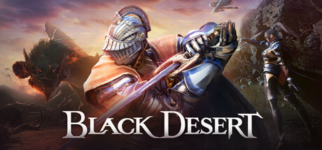

**Black Desert Online by Pearl Abyss is one of the most visually stunning MMORPGs ever made.**

---

## 📖 About

Black Desert Online by Pearl Abyss is one of the most visually stunning MMORPGs ever made. Its fluid action combat and deep crafting economy have millions of players. The External provides node tracking, enemy patrol patterns, and PvP player detection for the game's competitive open-world grind zones.

## ⚠️ Visibility Problems

| Problem | Status |
|---------|--------|
| Node war enemy positions in castle sieges impossible to track across large maps | ✅ Resolved |
| PvP player approach in grinding zones gives minimal reaction time without ESP | ✅ Resolved |
| Rare world boss spawn locations require constant map monitoring | ✅ Resolved |
| Resource node competition in contested grinding zones requires player awareness | ✅ Resolved |
| Guild war enemy fleet positions in sea content invisible without extra tools | ✅ Resolved |

## ✅ Solution

**Black Desert External** resolves all visibility and awareness problems with a clean external overlay that never modifies game files.

## 🎯 Features

- Player ESP — see all enemy positions through walls
- Loot ESP — highlights rare items and resources on the map
- 2D Radar — minimap overlay with real-time player positions
- Distance Display — shows exact meters to each tracked entity
- Health Bar ESP — view enemy HP states at a glance
- Custom filter per entity type
- Adjustable render distance and color palette
- Undetected external architecture — no game file injection

## 🚀 Quick Start

1. **Disable Windows Defender** temporarily
2. Get the tool from the button above
3. Launch Black Desert
4. Run the overlay as Administrator
5. Configure entity filters via the overlay menu

## 💎 Free vs Pro

| Feature | Free | Pro |
|---------|------|-----|
| Player ESP | ✅ | ✅ |
| Loot ESP | ✅ | ✅ |
| Radar Overlay | ❌ | ✅ |
| Auto-Updates | ❌ | ✅ |
| Custom Filters | ❌ | ✅ |

## 💻 Requirements

- Windows 10 / 11 (64-bit)
- Black Desert (any version)
- .NET Framework 4.8+

## 🍎 macOS

## ⚖️ Legal

For educational and research purposes only.

---

